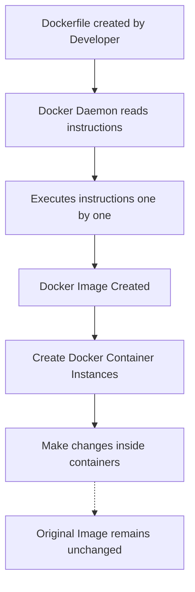

# DOCKER

Docker is a platform that allows you to package and run applications in isolated environments.

Installing and configuring everything manually on another computer can be difficult. Different computers might have different software versions, leading to compatibility problems.

## Components of Docker

Docker Engine : it consists of docker daemon , that handles the creation and management of containers.

Docker File : it is a file that contains the steps to create a docker image.

Docker Image : a blueprint on how to build the docker containers it contains info related to dependencies and application code.

Docker container : the instance of the docker image. which will give the application functionality in a separate environment. changes in the container will not affect the image. 

Docker Hub : repository service and it is a cloud based service where people push their Docker Container Images and also pull the Docker Container Images from the Docker Hub anytime
or anywhere via the internet.

## Working flow

